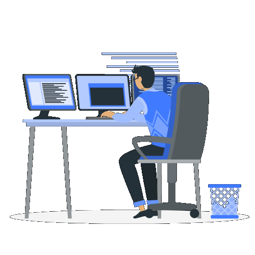

<!-- ============================== HEADER ============================== -->
<div align="center">


<a href="https://git.io/typing-svg">
  
</a>

<br/>

<a href="https://www.linkedin.com/in/asemgado/"></a>
<a href="mailto:asemgadou@outlook.com"></a>
<a href="https://github.com/Asemgado?tab=followers"></a>


</div>

<br/>

<!-- ============================== ABOUT ============================== -->
##  About Me



- 🧑‍💻 **Software Engineer / Backend Developer** — I design and ship APIs, ERPs and AI-powered platforms used in production
- 🎓 **M.Sc. in Computer Science** at **Mansoura University** *(Oct 2026 – present)*
- 🎓 **B.Sc. in Computer Science & AI** — [Damietta University](https://www.du.edu.eg/) *(2020 – 2025)*
- ⚙️ Day-to-day: **C# / .NET Core**, **Python / FastAPI**, **Laravel / Livewire**, **Node.js**
- 🤖 Building **AI agents** with **LangGraph** and multiple LLM providers (OpenAI, Gemini)
- 📨 Into **event-driven architecture** — RabbitMQ, async workflows, real-time integrations
- 🏆 Top 10% globally in **IEEEXtreme** · competitive programmer on **Codeforces**, **LeetCode**, **ECPC**
- 💼 Open to **Backend / .NET** opportunities — [View my Resume](https://docs.google.com/document/d/1PFFev8X5FWzHtPqI6cOJRKy5ZKBKy0CluyJ0xw_TzRA/edit?usp=sharing)

<br clear="right"/>

```csharp
public sealed class AsemGado : SoftwareEngineer
{
    public string   Role      => "Backend Developer";
    public string   Location  => "Egypt 🇪🇬";
    public string[] Languages => ["C#", "Python", "C/C++", "TypeScript", "PHP", "SQL"];
    public string[] Focus     => ["Scalable APIs", "ERP Systems", "AI Agents", "Event-Driven Systems"];

    public string CurrentlyLearning() => "Distributed systems & applied AI — M.Sc. @ Mansoura University";
    public string Motto()             => "Use software to solve real problems.";
}
```

<!-- ============================== EXPERIENCE ============================== -->
## 💼 Experience

<details open>
<summary><b>Backend Developer</b> · Yanabea App &nbsp;<sub><i>Aug 2026 – Oct 2026</i></sub></summary>
<br/>

- Revamped legacy Blade PHP pages into modern **Livewire** components
- Refactored and optimized database queries for better performance and maintainability
- Built new modules: **Purchase Orders** and **Inventory Management**

</details>

<details>
<summary><b>.NET Developer</b> · United Integrated Solutions &nbsp;<sub><i>Nov 2025 – Jul 2026</i></sub></summary>
<br/>

- Built and improved many screens in **U-Control ERP** across core business modules
- Developed the **U-Control API** and automated workflows with **.NET Core** for real-time integration
- Integrated the ERP with **POS** and third-party systems for seamless data sync and reporting
- Shipped mobile **push notifications** for admins — **approval time cut by 50%**
- Eliminated **N+1 queries**, significantly reducing load times and API latency
- Worked on **HR, CRM and E-commerce** platforms
- Introduced **RabbitMQ** for reliable asynchronous communication between services

</details>

<details>
<summary><b>Backend Developer</b> · InBots-MacSoft &nbsp;<sub><i>Jun 2025 – Nov 2025</i></sub></summary>
<br/>

- Delivered **4+ production apps** serving **15,000+ users** — real estate (Aleen, Deyar Dak), AI (Thrallhub), GIS & IoT (KelTech IoE – LOC)
- Built REST APIs for **10,000+ property listings**, improving search performance by **60%**
- Designed an **AI social-media automation** platform — **80% less manual posting** for 200+ users, 10,000+ automated posts / month, powered by **LangGraph** agents
- Scalable services with **FastAPI, Express, Node.js** on **PostgreSQL, MongoDB, Redis** — **sub-100 ms** on 95% of requests
- Deployed on **Contabo** and **Google Cloud Run** behind **Nginx** with **99.5% uptime**

</details>

<!-- ============================== TECH STACK ============================== -->
## 🛠️ Tech Stack

<div align="center">

**Languages**


**Frameworks & Runtimes**


**Databases & Messaging**


**DevOps, Cloud & Tools**


**AI & More**


</div>

<!-- ============================== GITHUB STATS ============================== -->
## 📊 GitHub Analytics

<div align="center">


</div>

<!-- ============================== COMMUNITY ============================== -->
## 🌱 Community & Leadership

| | |
|---|---|
| 🏁 **ACPC DU Club** — *Co-founder* | Built a CP/PS community of **150+ members**, ran 25+ trainings & 10+ contests, mentored **30+ students** to ECPC qualification |
| ⚡ **IEEE DU SB** — *CS Committee Lead* | Led **20+ members**, organized 15+ technical events reaching **500+ participants**; Top 10% in IEEEXtreme, CTF wins |
| 🏆 **Damietta Competitive Contest** — *Coordinator* | Ran the first inter-university CP contest in Damietta governorate — **100+ participants** |
| 🚀 **NASA Space Apps** — *Participant* | Designed, built and pitched an app in 3 days, competing against **100+ teams** |
| 🖥️ **UCCD DU** — *Infrastructure* | Administered systems and supported **200+ students** |

## 📜 Certifications

- 🤖 **AI & Data Science** — Samsung Innovation Campus *(2024)*
- 🌐 **ASP.NET Core** — ITI Summer Training & DEPI Program *(2023 – 2024)*
- 🔐 **CCNA & Cybersecurity Essentials** — Cisco Networking Academy *(2021 – 2022)*

<!-- ============================== SNAKE ============================== -->
## 🐍 Contribution Snake

<div align="center">
<picture>
  <source media="(prefers-color-scheme: dark)" srcset="https://raw.githubusercontent.com/Asemgado/Asemgado/output/github-snake-dark.svg" />
  <source media="(prefers-color-scheme: light)" srcset="https://raw.githubusercontent.com/Asemgado/Asemgado/output/github-snake.svg" />
  
</picture>
</div>

<!-- ============================== FOOTER ============================== -->
<div align="center">

<a href="https://github.com/piyushsuthar/github-readme-quotes">
  
</a>


</div>
